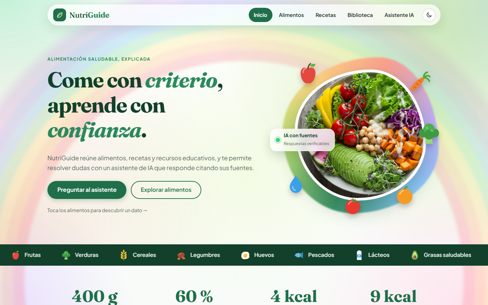
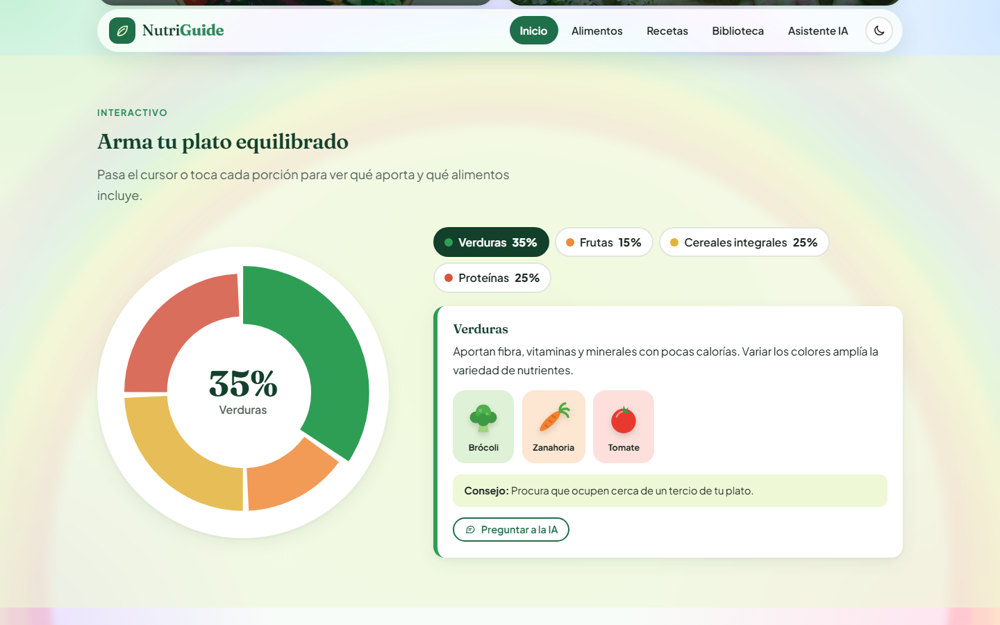
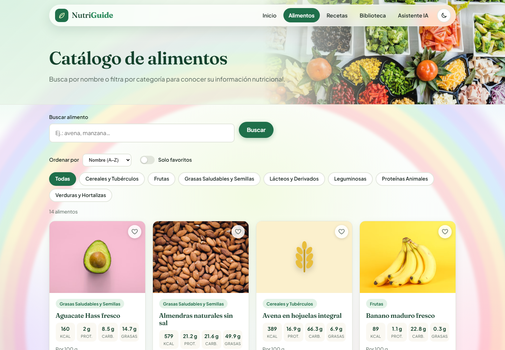
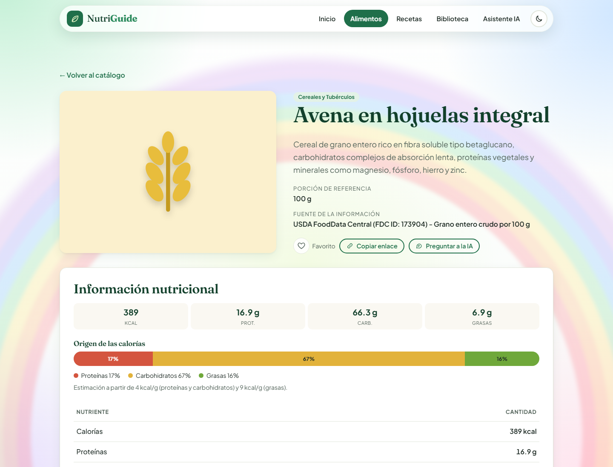
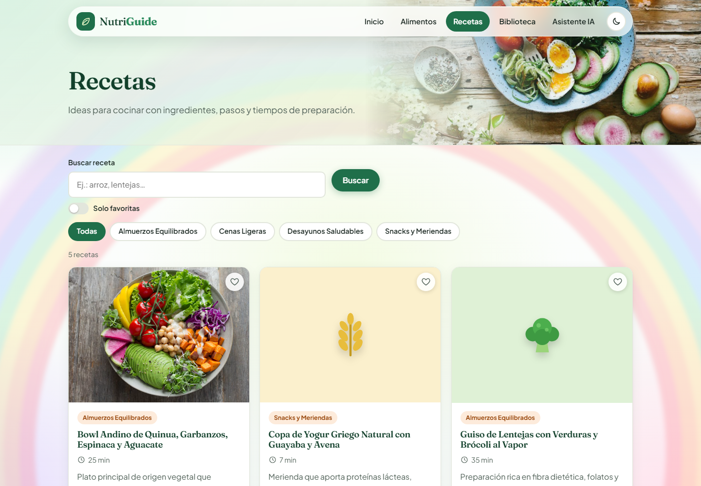
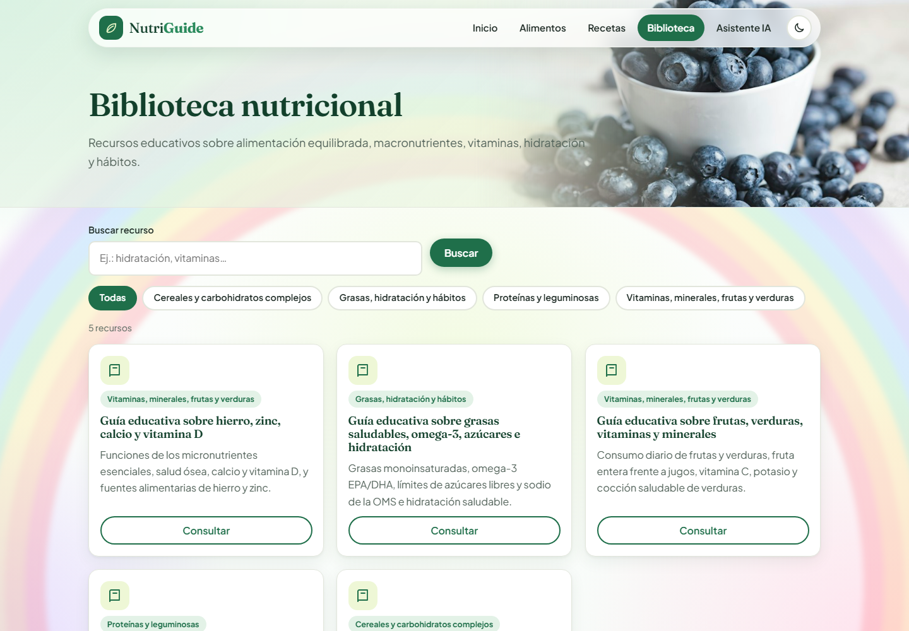
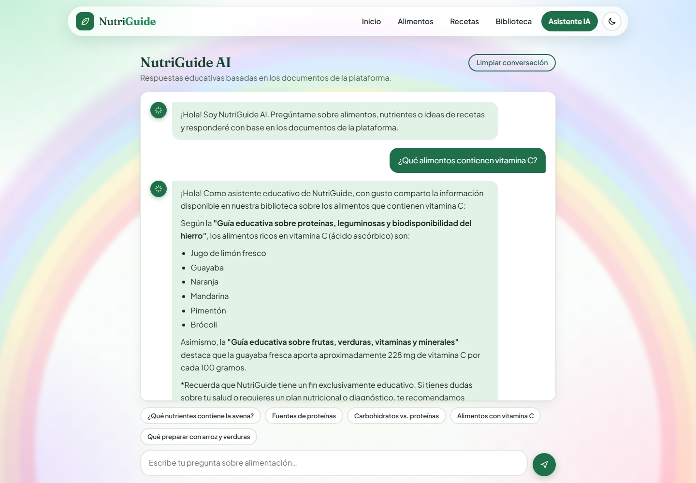
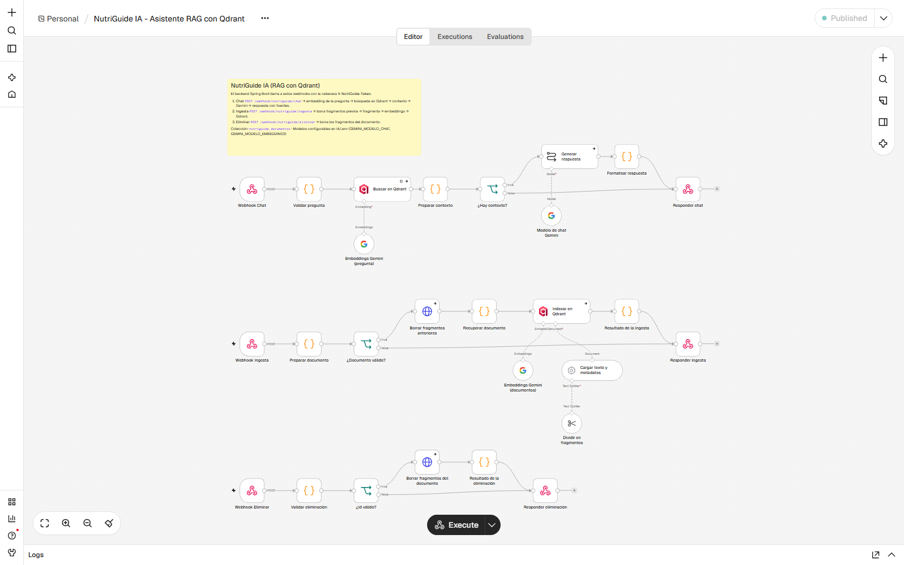
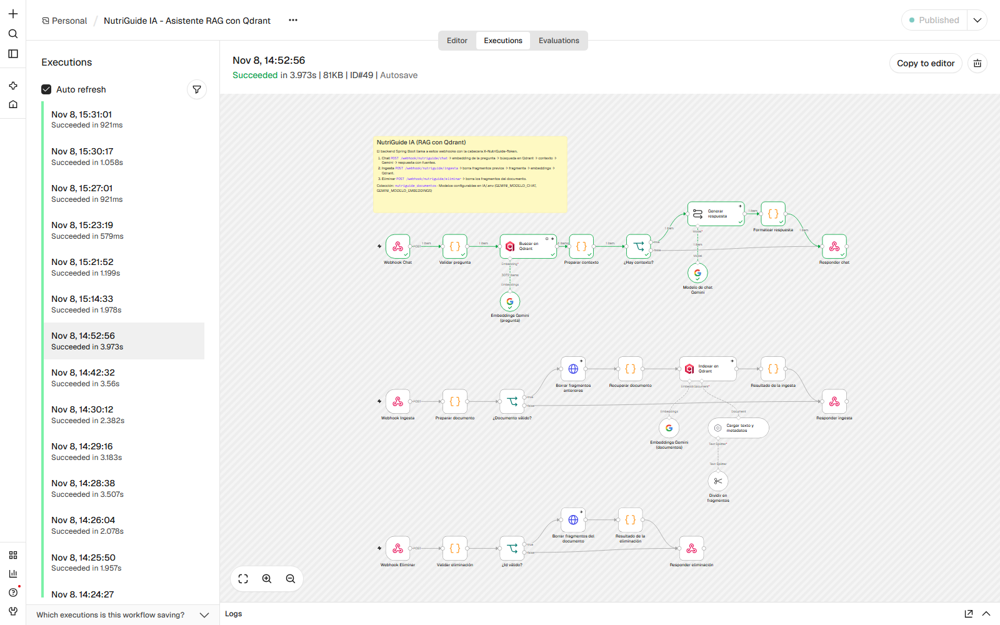

# NutriGuide – Asistente inteligente de alimentación



## Contexto

**NutriGuide** es una plataforma web educativa sobre alimentación saludable. Con ella puedes:

- consultar un **catálogo de alimentos** con su información nutricional (calorías, proteínas, carbohidratos, grasas, fibra…);
- explorar **recetas** con ingredientes, preparación y valores por porción;
- leer una **biblioteca** de guías educativas basadas en referencias de la OMS, la FAO y el ICBF;
- preguntar a **NutriGuide AI**, un asistente que responde **solo con lo que dicen los documentos de la biblioteca** y cita sus fuentes.

El asistente usa **RAG** (*Retrieval-Augmented Generation*):

1. Los documentos se dividen en fragmentos.
2. Cada fragmento se convierte en un vector (*embedding*) y se guarda en la base vectorial **Qdrant**.
3. Ante una pregunta, se buscan los fragmentos más parecidos.
4. **Google Gemini** redacta la respuesta usando únicamente esos fragmentos.

Si no encuentra información suficiente, lo dice en lugar de inventar. Si la pregunta es médica, recomienda acudir a un profesional. Todo el flujo de IA vive en **n8n**.

> **Aviso:** NutriGuide es una herramienta educativa. No diagnostica enfermedades, no prescribe dietas y no reemplaza la orientación de un profesional de la salud.

## Arquitectura

```
┌──────────────┐     ┌────────────────────────────┐     ┌───────────────────────────────┐
│   Frontend   │────►│  Backend (Spring Boot)     │────►│  IA: n8n (flujo RAG)          │
│ HTML/CSS/JS  │     │  /api/alimentos, /recetas, │     │   ├─ Qdrant (base vectorial)  │
└──────────────┘     │  /documentos, /chat        │     │   └─ Google Gemini            │
                     └─────────────┬──────────────┘     └───────────────────────────────┘
                                   ▼
                         PostgreSQL (datos relacionales)
```

| Componente | Tecnología | Función |
|---|---|---|
| Frontend | HTML5, CSS3 y JavaScript puro (sin frameworks) | Interfaz. Solo habla con el backend. |
| Backend | Java 21, Spring Boot 3.4, Maven Wrapper | API REST, sirve el frontend y llama a los webhooks de n8n con un token compartido. |
| Base de datos | PostgreSQL 16 (Docker) | Alimentos, recetas y documentos. |
| Orquestación de IA | n8n 2.46.6 (Docker) | Fragmenta, genera embeddings, busca y redacta respuestas. |
| Base vectorial | Qdrant 1.20.0 (Docker) | Guarda y busca los fragmentos (colección `nutriguide_documentos`, 3072 dimensiones, coseno). |
| Modelos | Google Gemini | `gemini-embedding-001` (embeddings) y `gemini-3.5-flash-lite` (respuestas). Se configuran en `IA/.env`. |

## Cómo inicializar el proyecto (paso a paso)

Funciona igual en **Windows, Ubuntu y macOS**. **No hay scripts de arranque:** al ejecutar el backend, Spring Boot levanta solo los contenedores de PostgreSQL, n8n y Qdrant.

### 1. Requisitos

| Herramienta | Versión | Comprobar |
|---|---|---|
| Git | cualquiera | `git --version` |
| JDK | 21 | `java -version` |
| Docker | Docker Desktop (Windows/macOS) o Docker Engine + plugin compose (Ubuntu) | `docker --version` y `docker compose version` |
| IntelliJ IDEA (opcional) | Community o Ultimate | — |
| Node.js (solo para las pruebas del frontend) | 18 o superior | `node --version` |

No hace falta instalar Maven, porque el proyecto incluye el Maven Wrapper (`mvnw`).

En **Ubuntu**, si Docker aún no está instalado:

```bash
sudo apt update
sudo apt install -y openjdk-21-jdk docker.io docker-compose-v2
sudo usermod -aG docker $USER     # cierra sesión y vuelve a entrar para usar docker sin sudo
```

### 2. Clonar el repositorio

```bash
git clone https://github.com/Mafeqm/Nutriguide.git
cd Nutriguide
```

### 3. Configurar la clave de Google Gemini (necesaria para el chat)

1. Crea una clave gratuita en <https://aistudio.google.com/apikey>.
2. Ponla en `IA/.env`:

```bash
# Si IA/.env no existe, créalo a partir del ejemplo:
cp IA/.env.example IA/.env          # Windows (PowerShell): Copy-Item IA\.env.example IA\.env
```

```properties
# IA/.env
GEMINI_API_KEY=tu_clave_de_gemini
```

Todo lo demás (contraseñas, tokens, puertos) ya tiene valores de desarrollo y funciona sin tocar nada. Las variables opcionales están documentadas en [IA/.env.example](IA/.env.example) y [backend/.env.example](backend/.env.example).

### 4. Encender Docker

- **Windows / macOS:** abre Docker Desktop y espera a que diga *Engine running*.
- **Ubuntu:** `sudo systemctl start docker`

### 5. Ejecutar el backend (levanta también los contenedores)

**Opción A: IntelliJ IDEA**

1. *File → Open* y elige la carpeta `backend` (o `backend/pom.xml`). Si IntelliJ lo pregunta, carga el proyecto Maven.
2. Comprueba que el SDK del proyecto es Java 21 (*File → Project Structure → SDK*).
3. Abre `backend/src/main/java/com/nutriguide/NutriGuideApplication.java` y pulsa ▶ **Run**.

**Opción B: terminal**

```bash
cd backend

# Windows (PowerShell o CMD)
mvnw.cmd spring-boot:run

# Ubuntu / macOS
chmod +x mvnw        # solo si el archivo perdió el permiso de ejecución
./mvnw spring-boot:run
```

Al arrancar, Spring Boot hace lo siguiente:

1. Ejecuta `docker compose up` con `backend/docker-compose.yml`, que incluye `IA/docker-compose.yml`, y espera a que **PostgreSQL, Qdrant y n8n** estén listos. La primera vez descarga las imágenes y tarda unos minutos.
2. n8n crea sus credenciales e **importa y publica solo el flujo** `IA/nutriguide-ia.json`.
3. Lee `backend/.env` e `IA/.env`, sin necesidad de exportar variables.
4. Crea las tablas y carga los datos iniciales (`db/schema.sql` y `db/data.sql`).
5. Envía los 5 documentos de `initial-docs/` a n8n, que los indexa en Qdrant.
6. Sirve el frontend en el mismo puerto.

Cuando en la consola aparezca `Started NutriGuideApplication`, el proyecto está listo.

### 6. Abrir la aplicación

| Servicio | URL | Acceso |
|---|---|---|
| **Aplicación (frontend)** | <http://localhost:8080> | — |
| API del backend | <http://localhost:8080/api/alimentos> | — |
| Editor de n8n | <http://localhost:5680> | La primera vez pide crear una cuenta local de propietario. |
| Panel de Qdrant | <http://localhost:6333/dashboard> | API key: valor de `QDRANT_API_KEY` en `IA/.env` (por defecto `nutriguide-dev-qdrant`). |
| PostgreSQL | `localhost:5434`, base `nutriguide_db` | Usuario `nutriguide` / `nutriguide_dev_pass`. |

Prueba rápida del asistente desde la terminal:

```bash
# Ubuntu / macOS
curl -X POST http://localhost:8080/api/chat/preguntar \
  -H "Content-Type: application/json" \
  -d '{"pregunta":"¿Qué nutrientes contiene la avena?"}'
```

```powershell
# Windows (PowerShell)
Invoke-RestMethod -Method Post -Uri http://localhost:8080/api/chat/preguntar `
  -ContentType 'application/json; charset=utf-8' `
  -Body ([Text.Encoding]::UTF8.GetBytes('{"pregunta":"¿Qué nutrientes contiene la avena?"}'))
```

### 7. Detener, reiniciar y limpiar

Al detener la aplicación, los contenedores **siguen encendidos** para que el siguiente arranque sea rápido. Usa estos comandos desde la carpeta `backend`:

```bash
docker compose ps                    # ver el estado de los contenedores
docker compose logs -f n8n           # ver los registros de n8n
docker compose stop                  # apagar los contenedores (conserva los datos)
docker compose start                 # volver a encenderlos
docker compose restart n8n           # reimportar y publicar el flujo tras cambiar IA/nutriguide-ia.json o IA/.env
docker compose down                  # eliminar los contenedores (los volúmenes con datos se conservan)
docker compose down -v               # eliminar contenedores Y datos (base de datos, vectores y n8n)
```

### 8. Ejecutar las pruebas

```bash
# Backend: 22 pruebas unitarias y de integración (usa Testcontainers, Docker debe estar encendido)
cd backend
./mvnw test                          # Windows: mvnw.cmd test

# Frontend: 12 pruebas unitarias con node:test
cd ../frontend
node --test
```

### Problemas frecuentes

| Síntoma | Solución |
|---|---|
| El chat responde *«La clave de Google Gemini no es válida…»* o *«No se pudo consultar la base de conocimiento…»* | La `GEMINI_API_KEY` de `IA/.env` falta, es incorrecta o fue desactivada. Pon una nueva y ejecuta `docker compose restart n8n`. |
| *«El flujo de n8n no está publicado»* justo después de arrancar | n8n sigue registrando los webhooks. Espera unos segundos y repite. |
| *«No se pudo conectar con el servicio de IA»* | El contenedor `nutriguide-n8n` está apagado. Ejecuta `docker compose up -d` en `backend`. |
| `Port 5434/5680/6333 is already allocated` | Otro programa usa ese puerto. Cambia `DB_PORT` en `backend/.env` o `N8N_PUERTO` en `IA/.env`. |
| `Cannot connect to the Docker daemon` | Docker no está encendido (paso 4). |
| `./mvnw: Permission denied` (Ubuntu) | `chmod +x mvnw` |

## Capturas

### Aplicación web

| | |
|---|---|
| **Inicio**: héroe ilustrado y accesos rápidos  | **Plato equilibrado interactivo**  |
| **Catálogo de alimentos** con búsqueda, filtros y favoritos  | **Detalle de un alimento** con su información nutricional  |
| **Recetas**  | **Biblioteca** de documentos educativos  |

**Asistente NutriGuide AI.** Esta es una respuesta real generada con Gemini a partir de los documentos de la biblioteca, con sus fuentes:



### Flujo de n8n

El archivo [IA/nutriguide-ia.json](IA/nutriguide-ia.json) contiene **un único flujo** con tres webhooks, protegidos con la cabecera `X-NutriGuide-Token`:



| Rama | Webhook | Qué hace |
|---|---|---|
| **1. Chat** | `POST /webhook/nutriguide/chat` | Validar pregunta → embedding con Gemini → **buscar en Qdrant** (top 4) → *Preparar contexto* (filtro por similitud mínima `RAG_MIN_SIMILARITY` y bloqueo de *prompt injection*) → **Gemini redacta la respuesta** → respuesta con fuentes. Sin contexto suficiente responde «No encontré información suficiente…». |
| **2. Ingesta** | `POST /webhook/nutriguide/ingesta` | Validar documento → borrar fragmentos anteriores → dividir en fragmentos (900 caracteres, solape de 150) → embeddings → **guardar en Qdrant** con sus metadatos. |
| **3. Eliminación** | `POST /webhook/nutriguide/eliminar` | Borra de Qdrant los fragmentos de un documento. |

Esta es una ejecución real de la rama de chat: la pregunta llega, se buscan 4 fragmentos en Qdrant y Gemini responde en unos 4 segundos.



Más detalles del flujo, el contrato de los webhooks y los resultados de las pruebas: [IA/README.md](IA/README.md).

## Estructura del proyecto

```
Nutriguide/
├── README.md                          Este documento
├── .gitattributes                     Finales de línea (LF para mvnw y scripts)
├── .gitignore
├── docs/
│   └── capturas/                      Imágenes de este README
│
├── frontend/                          Cliente web (HTML5 + CSS3 + JS puro) → frontend/README.md
│   ├── index.html                     Inicio
│   ├── pages/                         alimentos · detalle-alimento · recetas · biblioteca · asistente
│   ├── css/                           global (tokens, tema oscuro, fondo) · layout · components · responsive
│   ├── js/
│   │   ├── config.js                  URL del backend
│   │   ├── api.js                     Todas las peticiones HTTP (timeout, caché, reintento)
│   │   ├── normalize.js               Adapta el contrato del backend
│   │   ├── richtext.js                Formato seguro de las respuestas del asistente
│   │   ├── store.js                   Favoritos, tema e historial del chat
│   │   ├── illustrations.js           Ilustraciones SVG de alimentos
│   │   ├── main.js                    Utilidades de interfaz compartidas
│   │   └── home.js · alimentos.js · recetas.js · biblioteca.js · asistente.js
│   ├── assets/                        images/ (fotografías) · icons/
│   ├── tests/                         normalize.test.js · richtext.test.js
│   └── package.json
│
├── backend/                           API REST Spring Boot → backend/README.md
│   ├── pom.xml
│   ├── mvnw · mvnw.cmd · .mvn/        Maven Wrapper
│   ├── docker-compose.yml             PostgreSQL 16 + include de IA/docker-compose.yml
│   ├── .env · .env.example            Variables opcionales del backend
│   └── src/
│       ├── main/java/com/nutriguide/
│       │   ├── NutriGuideApplication.java     Clase principal (Run en IntelliJ)
│       │   ├── common/                Respuestas, excepciones y manejador global de errores
│       │   ├── config/                CORS, token de administración, límite del chat, carga inicial
│       │   ├── ia/                    IaConfig · N8nClient (cliente de los webhooks de n8n)
│       │   └── modules/
│       │       ├── alimento/          Entidad, repositorio, servicio, controlador y DTO
│       │       ├── receta/
│       │       ├── documento/         Incluye DocumentProcessor (extracción de PDF/TXT)
│       │       └── chat/
│       ├── main/resources/
│       │   ├── application.properties
│       │   ├── db/                    schema.sql · data.sql
│       │   └── initial-docs/          5 guías educativas que se indexan al arrancar
│       └── test/java/com/nutriguide/  Pruebas unitarias e integración (Testcontainers + n8n simulado)
│
└── IA/                                Asistente de IA → IA/README.md
    ├── docker-compose.yml             n8n + Qdrant
    ├── nutriguide-ia.json             Flujo completo de n8n (chat, ingesta y eliminación)
    ├── .env · .env.example            Clave de Gemini, modelos, umbral de similitud, tokens
    └── n8n/setup/
        ├── credenciales.js            Genera las credenciales de n8n desde las variables de entorno
        └── iniciar-n8n.sh             Importa credenciales y flujo, lo publica y arranca n8n
```

## API del backend

| Método | Ruta | Uso |
|---|---|---|
| GET | `/api/alimentos` · `/api/alimentos/{id}` | Catálogo y detalle de alimentos |
| GET | `/api/alimentos/buscar?nombre=` | Búsqueda por nombre (sin distinguir tildes) |
| GET | `/api/recetas` · `/api/recetas/{id}` | Recetas |
| GET | `/api/documentos` · `/api/documentos/{id}` | Biblioteca |
| POST | `/api/chat/preguntar` | Pregunta al asistente (el backend la reenvía al flujo de n8n) |
| POST/PUT/DELETE | `/api/alimentos`, `/api/recetas`, `/api/documentos` | Administración (requieren la cabecera `X-Admin-Token` = `ADMIN_TOKEN` de `backend/.env`) |

```json
// POST /api/chat/preguntar
{ "pregunta": "¿Qué alimentos contienen vitamina C?" }

// Respuesta
{
  "respuesta": "Según la «Guía educativa sobre proteínas, leguminosas…», los alimentos ricos en vitamina C son…",
  "fuentes": [
    { "titulo": "Guía educativa sobre proteínas, leguminosas y biodisponibilidad del hierro",
      "contenido": "Fragmento utilizado…", "similitud": 0.717 }
  ],
  "informacionSuficiente": true,
  "advertenciaEducativa": "Información con fines educativos…"
}
```

Los errores tienen la forma `{"exito": false, "mensaje": "…"}`, y el frontend muestra el `mensaje`.

## Equipo

- **Desarrollador 1:** frontend.
- **Desarrollador 2:** backend (Spring Boot), base de datos y sistema RAG.

## Pendiente

- Seguir afinando `RAG_MIN_SIMILARITY` (en `IA/.env`) con más preguntas reales a medida que crezca la biblioteca.
- Complementar las guías iniciales (síntesis del equipo) con documentos oficiales de FAO, OMS o ICBF, usando `POST /api/documentos`.
- Revisar las fotografías de los alimentos que aún no tienen una imagen verificada.
